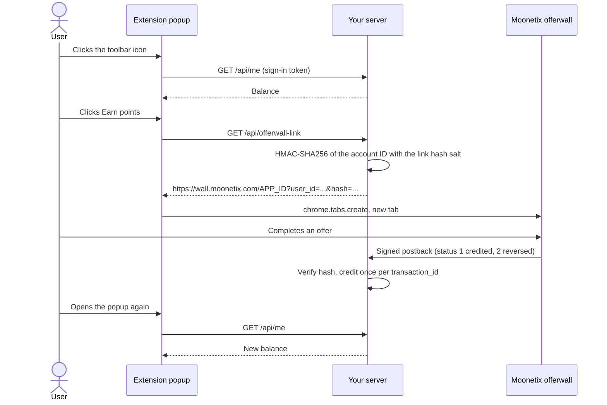

# Chrome Extension Offerwall (Manifest V3)

**A Manifest V3 extension with an optional Earn button: your server signs the Moonetix offerwall link, the popup opens it in a new tab, and points change only from verified postbacks.**

[](https://github.com/moonetix/offerwall-chrome-extension/actions/workflows/ci.yml)
[](LICENSE)
[](https://docs.moonetix.com/offerwall-link)
[](https://moonetix.com/register?from=github-offerwall-chrome-extension)
[](https://moonetix.com/academy/integrations/chrome-extension-offerwall)
[](https://moonetix.com/industries/browser-extensions)
[](https://moonetix.com/academy/monetization/monetize-browser-extension)

A Chrome extension in `extension/` and a small Node.js server in `server/` for the [Moonetix](https://moonetix.com) offerwall. Moonetix is an affiliate network: your users earn your own points by completing offers, and you earn per completed offer. The extension holds no key, ships no remote code, and only reads the balance back from your API.

> **Get your App ID and keys: sign up free at https://moonetix.com/register?from=github-offerwall-chrome-extension**

## Design choices

1. **Built for Chrome Web Store review.** One permission (`storage`), one host permission (your API), no `tabs` permission, no content scripts, no CDN scripts, and a setting that hides the Earn section. Nothing is injected into the pages users visit.
2. **No secret in the package.** Anyone can unzip an extension. The link hash salt and postback secret key stay in `server/.env`, and the link is signed for the account ID of the signed-in user.
3. **Tested in a real browser.** Server tests replay postbacks produced by the Moonetix signing code, and an end-to-end test loads the unpacked extension in Chrome for Testing, signs up, clicks Earn, checks the exact signed link in the new tab, and sees the credited balance.

## How it fits together



## Quick start

You need Node.js 22.13 or later, Chrome 116 or later, and an approved Moonetix app.

```bash
git clone https://github.com/moonetix/offerwall-chrome-extension.git
cd offerwall-chrome-extension/server
cp .env.example .env      # paste your App ID, link hash salt and postback secret key
npm start                 # http://127.0.0.1:3000
```

Then load the extension:

1. Open `chrome://extensions` and turn on Developer mode.
2. Click Load unpacked and pick the `extension` folder.
3. Click the extension icon, create an account, and click Earn points.

In the Moonetix dashboard:

1. Open Offerwalls, your offerwall, Integration, and copy the App ID and link hash salt into `server/.env`.
2. On the Postback page, copy the postback secret key into `server/.env` and save this postback URL:

```
https://YOUR_HOST/moonetix/postback?user={user_id}&tx={transaction_id}&event={event_id}&status={status}&reward={reward}&payout={payout}&offer={offer_name}&hash={hash}
```

| Variable | Required | Default | What it is |
| --- | --- | --- | --- |
| `MOONETIX_APP_ID` | yes | none | App ID from the Integration section. |
| `MOONETIX_LINK_SALT` | yes | none | Link hash salt from the Integration section. Server only. |
| `MOONETIX_POSTBACK_KEY` | yes | none | Postback secret key from the Postback page. Server only. |
| `MOONETIX_SUB1` | no | `extension` | Returned as `{sub1}` in postbacks. Not signed, reports only. |
| `PORT` | no | `3000` | Must match `API` in `popup.js` and `host_permissions`. |
| `HOST` | no | `127.0.0.1` | Listen address. |
| `DATABASE_PATH` | no | `./data.sqlite` | SQLite file, relative to `server/`. |
| `CURRENCY_NAME` | no | `Coins` | Shown in the popup. `.env.example` sets `Points`. |
| `SESSION_DAYS` | no | `30` | Lifetime of a sign-in token on the server. |

Before you publish, put the server on https, change `API` at the top of `extension/popup.js` and `host_permissions` in `extension/manifest.json` to that origin, add your icons, and run `npm run zip`.

## How it works

1. The popup page has a separate `popup.js`, as Manifest V3 requires. No inline script, no remote script.
2. The user signs in or creates an account on your server. Creating an account needs the "I am 16 or older" box. The extension keeps only the sign-in token, in `chrome.storage.session`, which lives in memory and is cleared when the browser restarts.
3. Each time the popup opens, it loads the balance from `GET /api/me`.
4. On a click on Earn points, the popup asks `GET /api/offerwall-link` for a fresh link. The server signs the account ID of the signed-in user with the link hash salt and adds `sub1=extension`. A user ID sent by the client is ignored.
5. The popup checks that the link's origin is exactly `https://wall.moonetix.com` and opens it with `chrome.tabs.create`. That call needs no `tabs` permission. The popup closes once the tab is in front, so nothing runs after it.
6. Moonetix calls `GET /moonetix/postback`. The server checks the hash first, credits on status 1 once per `transaction_id`, takes back the stored amount on status 2, and answers 200 only after the change is stored.
7. When the user clicks the icon again, the popup shows the new balance.

**Why a new tab and not the popup.** The Moonetix wall only loads in frames on the https website registered for your app, and an extension page is not that site. The popup is also at most 800x600 pixels and closes as soon as an offer opens a store page. `embed.js` is a remote script, which Manifest V3 does not run on extension pages.

| File | Purpose |
| --- | --- |
| `extension/manifest.json` | Popup, options page, `storage` permission, API host permission |
| `extension/popup.html`, `popup.js`, `popup.css` | Balance, sign-in, Earn button, sign out |
| `extension/options.html`, `options.js` | Setting that hides the Rewards section |
| `server/src/server.js` | HTTP routes |
| `server/src/moonetix.js` | Signed link, postback hash, amounts |
| `server/src/postback.js`, `store.js` | Postback handling and SQLite storage (`node:sqlite`) |
| `test/e2e.mjs` | Headless Chrome test of the unpacked extension |

## Chrome Web Store rules

Read the current policies yourself before you submit. How this build follows the ones that matter for an earn feature:

| Policy | What this repo does |
| --- | --- |
| Remote code (Manifest V3) | Fetches only JSON from your API. The wall is a normal website in a normal tab. |
| Ads: easy to remove, never forced | The extension's own features work signed out, and Settings hides the Rewards section. |
| Affiliate Ads: disclosed, user action | The popup says offers come from third parties and open in a new tab. The wall opens only from a click. Describe the feature in your listing and onboarding too. |
| Spam: no install incentives | Never give points for installing, rating, or reviewing your extension. |
| User data | Call your API over https only, and name Moonetix and the user ID it receives in your privacy policy. |

The extension never injects ads, offers, or scripts into websites, and it never sends notifications about offers.

## Security notes

- The link hash salt and the postback secret key are read from environment variables on the server. Never put them in the extension or in Git.
- The link is built on the server for the signed-in account only, and the popup opens only URLs whose parsed origin is `https://wall.moonetix.com`.
- The extension stores no balance and never tells the server that an offer was completed. Points change only from the signed postback.
- The postback hash is checked with `crypto.timingSafeEqual` before anything else. Tampered or wrongly signed postbacks get 403.
- `transaction_id` is the primary key of the transactions table, so a retry cannot credit twice. Credit and balance change run in one database transaction.
- A reversal subtracts the stored credited amount, only for a transaction credited to the same account. Balances can go below zero after a reversal; say in your terms that rewards can be taken back.
- `payout`, `offer`, `event` and sub IDs are not signed. They are used for display, logs and reports, never for money.
- Passwords are stored as scrypt hashes, sign-in tokens as SHA-256 hashes, and sign-in is rate limited per address.
- Reward users only for completed offers. Never reward installs, ratings, reviews, invites or other engagement. Users must be 16 or older.

## Test it

**Server**

```bash
npm test
```

No network and no Moonetix account needed. The tests check accounts and sign-in, that the link is signed for the signed-in account and matches links built by the Moonetix code for the same test keys, that no secret appears in any answer, and they replay real Moonetix postbacks (`server/test/fixtures/moonetix-vectors.json`): credit, retry, decimal rewards, another user's credit, reversal, repeated reversal, reversal of a never-credited `test_` transaction, unknown users, and tampered or wrongly signed postbacks.

**Postback route from the outside**

With the server running and an account created in the popup, [postback-tester](https://github.com/moonetix/postback-tester) sends Moonetix-signed postbacks to it: a credit and its retry, three kinds of reversal, four forged or unsigned requests and five parallel copies of one credit. It exits 1 on the first rule the handler breaks.

```bash
export MOONETIX_POSTBACK_KEY=your-postback-secret-key   # same value as in server/.env
npx github:moonetix/postback-tester --preset moonetix \
  'http://127.0.0.1:3000/moonetix/postback?user={user_id}&tx={transaction_id}&event={event_id}&status={status}&reward={reward}&payout={payout}&offer={offer_name}&hash={hash}' --user 1
```

**Extension in headless Chrome**

```bash
CHROME_PATH=/path/to/chrome-for-testing/chrome npm run test:e2e
```

Use [Chrome for Testing](https://googlechromelabs.github.io/chrome-for-testing/) or Chromium: branded Chrome ignores `--load-extension`. The test needs port 3000 free. It loads the unpacked extension, checks that every script comes from the package, signs up (and is refused without the 16+ box), clicks Earn, checks that the new tab opens the exact signed link for account `1`, sends a credited postback, sees `150 Points` in the reopened popup, checks that only the sign-in token is stored, and hides the Rewards section from Settings.

**With Moonetix**

1. Load the unpacked extension and create a test account. It gets user ID `1` on a fresh database.
2. In the dashboard, open Offerwalls, your offerwall, Integration. Under Integration status, use Check a link, then Test a link with user ID `1`. It must match the link your server returns.
3. Click Earn points from a normal home or mobile connection. The wall opens in a new tab, not the Link not valid page. VPNs, proxies, Tor and data center networks see a block page.
4. Click **Send a test postback** with user ID `1` and status 1. You can also send one from the Postback page. Open the popup again: the balance goes up once.
5. A status 2 test uses a new `test_` transaction ID that was never credited, so nothing changes. Every attempt is listed under Reports, Postbacks.
6. Right-click the popup, Inspect, and confirm that every request goes to your API.
7. Remove test rewards from your test accounts before launch.

## Common problems

| What you see | Why, and the fix |
| --- | --- |
| `node: .env: not found`, or `Missing environment variables: ...` | Run `npm start` from the repo root or `server/`, after `cp .env.example .env` in `server/`. |
| Popup says "The server is not reachable right now." | The server is not running, or `API` in `popup.js` and `host_permissions` do not match its origin. Reload the extension after you change them. |
| Popup says "Offers are not available right now." | `/api/offerwall-link` failed, or answered a URL whose origin is not `https://wall.moonetix.com`. Check the server log. |
| Sign-in fails with `too_many_attempts` (429) | Sign-in is rate limited per address. Wait a few minutes. |
| `test:e2e` prints `Set CHROME_PATH to a Chrome for Testing or Chromium binary.` | Branded Chrome ignores `--load-extension`. Point `CHROME_PATH` at Chrome for Testing, and free port 3000. |
| Postback answers `200 unknown_user` or `200 ignored: unknown user` | The `user` value is not an account in your database (`test_user` from a default dashboard test, for example). Nothing is credited. |

## Firefox and Edge

Edge loads the same package. Firefox supports `tabs.create` and `storage.session` in Manifest V3; test it and follow Mozilla's add-on policies before you publish there.

## Learn more

- Guide: [How to Add an Offerwall to a Chrome Extension (MV3)](https://moonetix.com/academy/integrations/chrome-extension-offerwall)
- Guide: [How to monetize a browser extension with an offerwall](https://moonetix.com/academy/monetization/monetize-browser-extension)
- Guide: [How to promote a browser extension or desktop app](https://moonetix.com/academy/strategy/promote-browser-extension-software)
- Docs: [Offerwall link](https://docs.moonetix.com/offerwall-link), [Postbacks](https://docs.moonetix.com/postbacks), [Credits and reversals](https://docs.moonetix.com/credits-and-reversals), [Testing](https://docs.moonetix.com/testing)
- Moonetix for browser extensions: [moonetix.com/industries/browser-extensions](https://moonetix.com/industries/browser-extensions)
- Free tools: [Offerwall link builder](https://moonetix.com/tools/offerwall-link-builder) and [Postback hash checker](https://moonetix.com/tools/postback-hash-checker)

## Get started

**Get your App ID and keys: sign up free at https://moonetix.com/register?from=github-offerwall-chrome-extension**

Every publisher application is reviewed by hand. Once you are approved, add your extension as an app, set your points name and rate, and paste the keys into `server/.env`.

## More Moonetix examples

**Start here**
- [awesome-offerwalls](https://github.com/moonetix/awesome-offerwalls): curated guides, tools and examples for offerwall publishers
- [offerwall-postback-handlers](https://github.com/moonetix/offerwall-postback-handlers): tested postback handlers in PHP, Node.js, Python and Java

**Web frameworks and backends**
- [offerwall-nextjs-starter](https://github.com/moonetix/offerwall-nextjs-starter), [offerwall-react-vite](https://github.com/moonetix/offerwall-react-vite), [offerwall-vue-nuxt](https://github.com/moonetix/offerwall-vue-nuxt), [offerwall-express](https://github.com/moonetix/offerwall-express), [offerwall-laravel](https://github.com/moonetix/offerwall-laravel), [offerwall-django](https://github.com/moonetix/offerwall-django)

**Apps, games and communities**
- [telegram-mini-app-offerwall](https://github.com/moonetix/telegram-mini-app-offerwall), [discord-rewards-bot](https://github.com/moonetix/discord-rewards-bot)

**Tools and data**
- [postback-tester](https://github.com/moonetix/postback-tester): signed test postbacks that catch double credits, missed reversals and forged requests
- [signup-guard](https://github.com/moonetix/signup-guard), [datacenter-ip-ranges](https://github.com/moonetix/datacenter-ip-ranges), [offerwall-fraud-playbook](https://github.com/moonetix/offerwall-fraud-playbook): fake sign-ups, datacenter traffic and reward fraud
- [reward-economy-kit](https://github.com/moonetix/reward-economy-kit), [referral-engine](https://github.com/moonetix/referral-engine), [gamification-kit](https://github.com/moonetix/gamification-kit): points math, referrals and retention
- [affiliate-postback-macros](https://github.com/moonetix/affiliate-postback-macros), [country-tiers](https://github.com/moonetix/country-tiers): postback formats of other networks and country tiers for targeting

## License

MIT. See [LICENSE](LICENSE).
